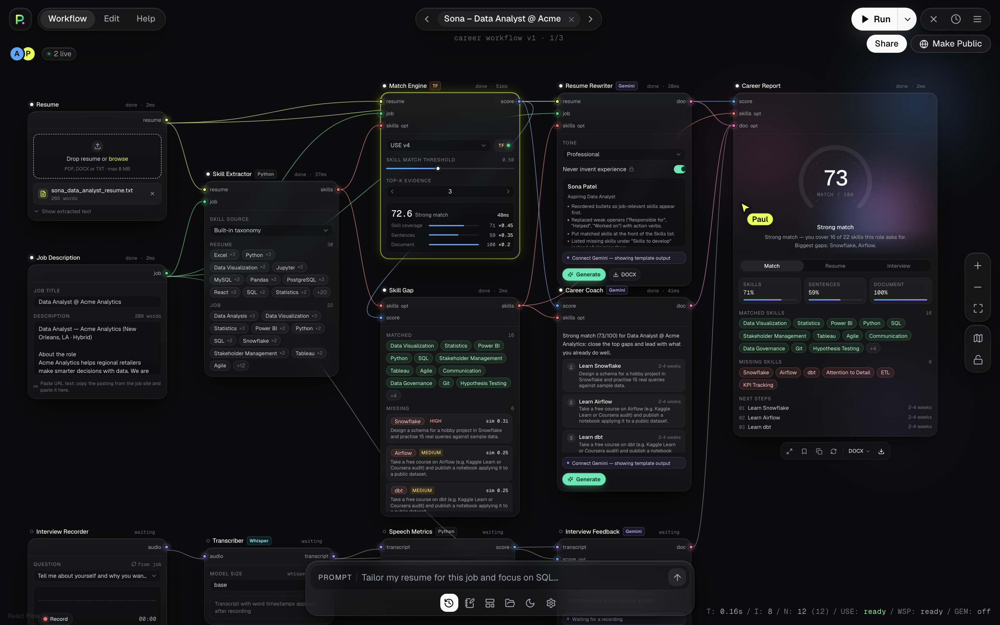

# PAOwerUp Careers

AI job-preparation workspace for students: CMPS 4010 team project, Southeastern Louisiana University.

Upload a resume and a job description, and PAOwerUp:

1. **scores the match** with **TensorFlow + Universal Sentence Encoder (USE)**: an overall score, matched skills (with evidence) and missing skills;
2. **rewrites the resume** for the job with **Google Gemini**, without inventing experience, and exports it as **DOCX**;
3. gives **personalized career guidance** (Gemini);
4. runs a **mock interview**: record an answer in the browser, **Whisper** transcribes it, Python measures pace, filler words and pauses, and Gemini gives feedback.

Everything happens on a dark node-based **workflow canvas**. Each step is a card, and data flows along colored wires.



---

## Quick start

Requirements: **Python 3.11**, **Node 20+**, **FFmpeg**. The first run downloads the USE model (~1 GB) and Whisper *base* (~140 MB).

### macOS

```bash
brew install python@3.11 node ffmpeg   # skip any you already have
make setup                             # venv + pip + npm + backend/.env
make dev                               # backend :8000 + frontend :5173
```

Open **http://localhost:5173**, then press **Run** (or ⌘↵).

### Windows (PowerShell)

```powershell
winget install Python.Python.3.11 OpenJS.NodeJS.LTS Gyan.FFmpeg   # then open a new terminal
powershell -ExecutionPolicy Bypass -File scripts\setup.ps1
powershell -ExecutionPolicy Bypass -File scripts\dev.ps1
```

`make` also works on Windows if you have it (e.g. Git Bash + `choco install make`), but you would need to adjust the venv paths. The PowerShell scripts are the supported route.

### Gemini (optional)

Put a key from [Google AI Studio](https://aistudio.google.com/apikey) in `backend/.env`:

```
GEMINI_API_KEY=your-key
GEMINI_MODEL=gemini-2.5-flash
```

**Without a key the app still runs end to end.** The Gemini nodes show a "Connect Gemini" note and produce deterministic template output, so the TensorFlow and Whisper parts can be demoed offline.

### Tests

```bash
make test        # or: scripts\test.ps1
```

There are 25 pytest tests: skill extraction (aliases, symbols like C++/C#, word boundaries), the scoring math, an end-to-end match on a strong and a weak fixture pair (the strong pair must score ≥30 points higher), speech metrics, every API endpoint including DOCX export, and the presence WebSocket. The tests never call Gemini.

---

## Demo script (≈3 minutes)

1. The app opens on **Sona – Data Analyst @ Acme** (strong-match sample), already wired. Press **Run**.
   Watch nodes go *queued → running → done*: wires light up in their data color and the running node glows.
2. The **Career Report** gauge counts up to **~73 / Strong match**: 16 of 22 job skills covered, with gaps Snowflake, Airflow and dbt.
   Open **Skill Gap** for "how to learn it" hints, then **Match Engine** for the three score components.
3. Drag the **Skill match threshold** slider to 0.80 and run again; semantic matches drop out and the score falls. Set it back.
4. Press **›** in the top bar to switch samples. **Marcus – Data Analyst** (a kitchen lead) scores ~5, a weak match.
5. Report toolbar → **DOCX ▾ → Download** gets the improved resume. Switch the format to PDF for the full report.
6. **Interview Recorder** → pick a question → **Record** for 20–40 s → **Stop**. The transcript, WPM, filler words and feedback appear,
   and the report's *Interview* tab fills in.
7. Open the app in a second browser tab to see live cursors and avatars.

Type in the bottom **Prompt** bar (e.g. *"focus on SQL and keep it to one page"*) and press Enter to re-run the Gemini nodes with those instructions.

---

## How the TensorFlow match score works

*(This section is written to be presented. The code is in [backend/app/ml/matcher.py](backend/app/ml/matcher.py).)*

**The model.** The Universal Sentence Encoder (Google, loaded from TF-Hub with `tensorflow_hub`) turns any sentence into a
**512-number vector**. Sentences with similar meaning get vectors that point in similar directions, even when they share no words.
For example, *"Built a Tableau dashboard"* and *"Experience with data visualization tools"* end up close together.

**Step by step:**

| # | Step | TensorFlow work |
|---|------|-----------------|
| 1 | Split the resume and job description into sentences and bullet points | – |
| 2 | Find skills in both using our 299-skill taxonomy with aliases (`js` → JavaScript, `k8s` → Kubernetes) | – |
| 3 | Embed every sentence, every skill name and both whole documents with USE | `hub.load(...)`, one batched call per group |
| 4 | Normalize vectors to length 1, so **dot product = cosine similarity** | `tf.linalg.l2_normalize` |
| 5 | **Document similarity**: cosine of the whole-resume vs. whole-job vectors (overall topic fit) | `tf.reduce_sum(a * b)` |
| 6 | **Sentence similarity**: a matrix of every job sentence × every resume sentence; take each job sentence's best match and average them ("is every requirement addressed somewhere?") | `tf.matmul`, `tf.reduce_max`, `tf.reduce_mean` |
| 7 | **Skill coverage**: a job skill named in the resume is an *exact* match (credit 1.0). Otherwise compare its vector to every resume skill and sentence; if the best cosine ≥ **threshold** (default 0.50) it's a *semantic* match with credit = that similarity, and if not it's **missing**. Skills are weighted by importance (how often they appear and whether the sentence says *required* or *nice to have*). The top-k most similar resume sentences are kept as evidence. | `tf.matmul`, `tf.math.top_k`, `tf.argmax` |
| 8 | Rescale raw cosines to 0–1 (raw USE values for related text sit between ~0.1 and ~0.75) | `tf.clip_by_value` |
| 9 | **Blend**: `score = 100 × (0.45·skill coverage + 0.35·sentence similarity + 0.20·document similarity)` | `tf.reduce_sum(parts * weights)` |
| 10 | **Verdict**: ≥70 Strong, ≥55 Good, ≥40 Fair, otherwise Weak | – |

The weights and calibration ranges are constants at the top of `matcher.py` (`W_SKILLS`, `W_SENTENCES`, `W_DOCUMENT`,
`DOC_FLOOR/CEIL`, `SENT_FLOOR/CEIL`). All similarity math runs in TensorFlow, not NumPy. On a laptop CPU a match takes
~40 ms once the model is warm.

**Results on the samples:** Sona vs. Data Analyst → 72.6 (Strong) · Sona vs. Frontend Engineer → 33 (Weak) · Marcus (kitchen lead) vs. Data Analyst → ~5 (Weak).

The Match Engine node also offers **USE Large v5** (a transformer-based encoder, more accurate and slower). It downloads on first use.

---

## Architecture

```
┌──────────────── Browser (React + React Flow) ────────────────┐
│ Canvas: 12 node cards, typed ports, bezier wires              │
│ Graph runner: topological, parallel branches, streams status  │
│ Zustand store ── localStorage (workflow + last results)       │
└───────┬───────────────────────────────┬──────────────────────┘
        │ /api/* (JSON, multipart)       │ /ws/presence (cursors)
┌───────▼───────────────────────────────▼──────────────────────┐
│ FastAPI (Python 3.11)                                         │
│  ml/matcher.py ─ TensorFlow + USE (loaded once at startup)    │
│  ml/skills.py  ─ taxonomy extraction (data/skills.json)       │
│  ml/whisper_service.py ─ FFmpeg → 16 kHz WAV → Whisper        │
│  ml/speech.py  ─ WPM, fillers, pauses, clarity                │
│  services/gemini.py ─ google-genai, JSON schemas + fallbacks  │
│  services/documents.py ─ PDF/DOCX/TXT in, DOCX out            │
└───────────────────────────────────────────────────────────────┘
```

### The workflow

| Node | In → Out | Engine |
|---|---|---|
| Resume | – → `resume` | pdfplumber / python-docx |
| Job Description | – → `job` | – |
| Skill Extractor | resume, job → `skills` | taxonomy (+ optional Gemini) |
| Match Engine | resume, job, skills → `score` | **TensorFlow + USE** |
| Skill Gap | skills, score → `skills` | – |
| Resume Rewriter | resume, job, skills → `doc` | Gemini |
| Career Coach | score, skills → `doc` | Gemini |
| Interview Recorder | – → `audio` | MediaRecorder (browser) |
| Transcriber | audio → `transcript` | Whisper |
| Speech Metrics | transcript → `score` | Python |
| Interview Feedback | transcript, score, job → `doc` | Gemini |
| Career Report | score, skills, doc → – | preview + DOCX/PDF/MD export |

Wire colors: resume yellow, job green, skills coral, score blue, audio/transcript violet, documents pink. Only matching types
can connect; a mismatched drop shows a red reject animation.

### API

| Method | Path | Purpose |
|---|---|---|
| GET | `/api/health` | readiness of USE, Whisper, Gemini |
| POST | `/api/parse-resume` | multipart file → text |
| POST | `/api/skills` | skills on both sides |
| POST | `/api/match` | TensorFlow match result |
| POST | `/api/rewrite` | improved resume (structured JSON) |
| POST | `/api/rewrite/docx` | resume JSON → DOCX file |
| POST | `/api/coach` | next steps |
| POST | `/api/interview/questions` | questions for the job |
| POST | `/api/transcribe` | multipart audio (webm) → transcript + word timestamps |
| POST | `/api/speech-metrics` | WPM, fillers, pauses |
| POST | `/api/interview/feedback` | feedback |
| WS | `/ws/presence` | live cursors |

Interactive docs: http://127.0.0.1:8000/docs

### Project layout

```
backend/
  app/main.py            FastAPI app, model warm-up on startup
  app/api/               routers: health, match, coach, interview, presence
  app/ml/                matcher.py (TensorFlow), skills.py, speech.py, whisper_service.py
  app/services/          gemini.py, documents.py
  app/data/skills.json   299 skills with aliases + learning hints
  tests/                 pytest suite + fixtures
frontend/src/
  canvas/                Canvas, NodeShell (ports/glow), FlowEdge, presence cursors
  nodes/                 one component per node type
  components/            TopBar, ZoomRail, CommandBar, StatsReadout, NodePalette, dialogs, ui primitives
  store/graph.ts         Zustand graph + run state, persisted to localStorage
  lib/runner.ts          graph runner (dependency-ordered, parallel branches)
  styles/tokens.css      every color, radius and shadow as CSS variables
samples/                 2 resumes (TXT, plus PDF/DOCX copies) + 2 job descriptions
```

### Keyboard shortcuts

`⌘/Ctrl + Enter` run · `Space` add node (or right-click the canvas) · `F` fit view · `Delete` remove the selection · `Esc` close the palette

---

## Design decisions and defaults

- **React instead of Streamlit for the UI.** The application form listed Streamlit, but Streamlit can't render a
  pan/zoom node canvas with live wires and cursors. The frontend is React (Vite + TypeScript + React Flow), and **all AI/ML stays in Python**.
- **The repo root is the project root** (`backend/`, `frontend/`, `samples/` at top level), not a nested `paowerup-careers/` folder.
- **TensorFlow is the only thing that scores.** Gemini never touches the match score; it only adds optional extra skills
  (Skill Extractor → "Taxonomy + Gemini") and writes text.
- **The no-invention guard rail is enforced twice:** in the Gemini prompt, and server-side, where any missing skill Gemini puts in
  `skills` is moved to `skills_to_develop`. The "Never invent experience" toggle is locked on.
- **Ambiguous skill words** (Sales, Education, Research, …) only match through specific phrases, and short names (`R`, `C`, `Go`) are
  case-sensitive. This prevents "EDUCATION" headings or "sales data" from counting as skills.
- **Whisper runs locally on CPU** (`fp16=False`), default *base*. The model preloads in the background at startup; set
  `PRELOAD_WHISPER=0` to skip that.
- **Models are cached inside the project** (`backend/.cache/`) so macOS doesn't wipe them from `/tmp`.
- **Presence is real only.** Cursors and avatars come from other open tabs over the WebSocket. With one viewer you see just yourself.
  Set your display name in Settings.
- **"Share" copies the URL** and **"Make Public" is a local visibility flag.** There are no accounts or hosting in this prototype.
- **The "Paste URL text" note**: job postings are pasted as text. Scraping job sites is out of scope (logins, terms of service).
- **Persistence**: the workflow, settings, notes, run history and last results (including the last recording) are saved to localStorage.
